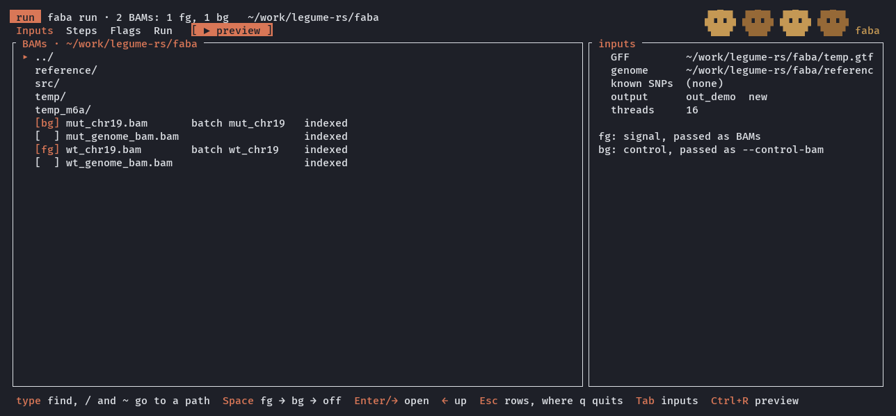
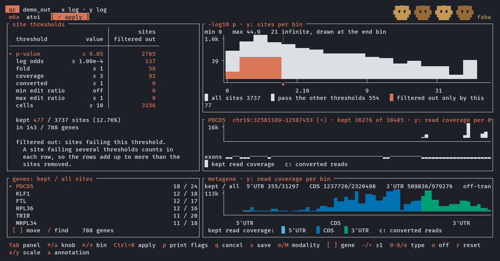
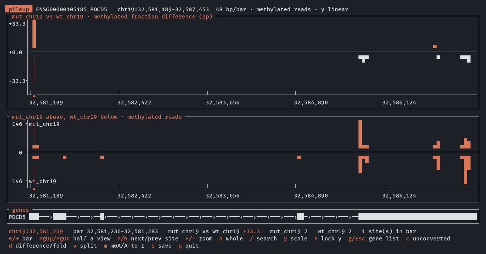
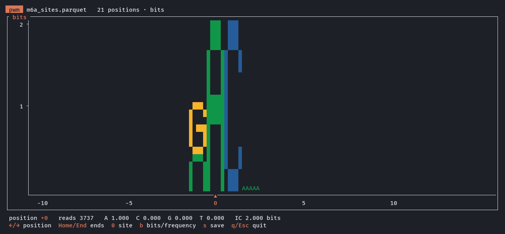

# faba

**F**eature statistics **A**ccumulator for **B**ase-pair-level **A**nalysis

`faba` extracts per-cell genomic features directly from alignment (BAM) files:
RNA modifications (DART-seq m6A, A-to-I editing), alternative polyadenylation
(APA), gene counts, read depth, and SNP genotypes.

## A quick look

Run in a terminal, `run`, `qc`, `pileup`, `metagene`, `pwm` and `modules` open full-screen
views; `--batch-process` skips them for scripts and clusters.

Each view runs as a detachable session: Ctrl+Alt+D leaves it running (as does a dropped
connection), and starting the command again with nothing named, or `faba attach`, returns
to it; Ctrl+Alt+S switches to another session. `faba sessions` lists them, `faba kill`
stops one as its quit key does (a write under way finishes first) and `faba rename`
labels one. `--no-detach` runs a view in the terminal only.

**`faba run`**: pick the BAMs (signal and control), steps and flags, preview the command, and run it.



**`faba qc`**: set site thresholds, see what each one keeps, and write a filtered copy.



**`faba pileup`**: browse a gene's modification sites, one track per batch.



**`faba pwm`**: the sequence logo around the called sites.



## Installation

### Prerequisites

These must be installed **before** running `cargo install` — Cargo only builds
Rust crates and cannot pull in a C toolchain or system libraries on its own. If
they are missing, the build fails midway in the vendored-htslib build script.

- **Rust** (stable, edition 2021+) — install via [rustup](https://rustup.rs).
- A **C/C++ toolchain** and the system libraries that
  [`rust-htslib`](https://github.com/rust-bio/rust-htslib) builds against
  (it vendors and compiles htslib, which needs the compression dev headers,
  and runs `bindgen`, which needs libclang):

  ```sh
  # Debian / Ubuntu
  sudo apt-get install build-essential clang libclang-dev \
      zlib1g-dev libbz2-dev liblzma-dev pkg-config

  # macOS (Homebrew)
  brew install llvm xz bzip2 zlib
  ```

### Install from crates.io

```sh
cargo install faba
```

Optional HDF5 (`.h5` / `.h5ad`) support:

```sh
cargo install faba --features hdf5
```

### Install from GitHub

```sh
cargo install --git https://github.com/causalpathlab/faba.git
```

Pin to a specific tag or branch if you need a reproducible build:

```sh
cargo install --git https://github.com/causalpathlab/faba.git --tag v0.14.0
cargo install --git https://github.com/causalpathlab/faba.git --branch main
```

### Build from a local clone

```sh
git clone https://github.com/causalpathlab/faba.git
cd faba
cargo build --release
cargo install --path .
```

### Optional features

| Feature | Enables | Extra requirement |
|---------|---------|-------------------|
| `mcp` (default) | `faba mcp`, the commands as tools for an agent | none |
| `hdf5`  | HDF5 backend + `.h5`/`.h5ad` readers | `libhdf5` on the build host |

There is no `cuda` / `metal` feature: nothing on the BAM-to-matrix path touches a
GPU.

Add them with `--features`:

```sh
cargo install --git https://github.com/causalpathlab/legume-rs.git faba --features hdf5
```

### Verify

```sh
faba --help
```

### Troubleshooting

Almost all install failures come from the `hts-sys` build step (it compiles a
vendored copy of htslib and generates bindings with `bindgen`). The fixes:

- **`thread 'main' panicked ... Unable to find libclang`** — `bindgen` can't
  locate libclang. Install `libclang-dev` (Debian/Ubuntu) or `brew install
  llvm` (macOS), then point to it:

  ```sh
  # Linux: the unversioned symlink ships with libclang-dev
  export LIBCLANG_PATH=$(llvm-config --libdir 2>/dev/null || echo /usr/lib/llvm-18/lib)

  # macOS (Homebrew llvm is keg-only)
  export LIBCLANG_PATH="$(brew --prefix llvm)/lib"
  ```

- **`fatal error: zlib.h / bzlib.h / lzma.h: No such file or directory`** — the
  compression **dev headers** are missing (the runtime `.so` alone is not
  enough). Install `zlib1g-dev libbz2-dev liblzma-dev` (Debian/Ubuntu) or
  `brew install xz bzip2 zlib` (macOS).

- **`error: linker 'cc' not found`** — no C toolchain. Install
  `build-essential` (Debian/Ubuntu) or Xcode Command Line Tools
  (`xcode-select --install`) on macOS.

- **`failed to run custom build command for 'hdf5-sys'`** — you passed
  `--features hdf5` without `libhdf5` on the host. Install `libhdf5-dev`
  (Debian/Ubuntu) or `brew install hdf5`, or drop the feature.

If a build fails after fixing a prerequisite, re-run with a clean rebuild of the
C bits: `cargo install --git ... faba --force`.

## Usage

```sh
faba <COMMAND> [OPTIONS]
```

| Command | Purpose |
|---------|---------|
| **Feature profiling — BAM → per-cell features** ||
| `dartseq` (`dart`, `m6a`) | Call DART-seq m6A sites by a WT-vs-MUT control contrast on C-to-T conversions |
| `atoi` (`a2i`, `editing`) | Detect and quantify A-to-I RNA editing sites |
| `apa` (`polya`)           | Quantify alternative polyadenylation sites per cell |
| `count` (`genes`)         | Count reads per gene and call cells (single-cell or bulk RNA-seq) |
| `depth` (`rd`)            | Compute read depth over genomic intervals |
| `snp` (`genotype`)        | Discover and genotype SNP variants from BAM pileup |
| `run` | Set up the pipeline in a view (inputs, steps, flags), preview and save the command, and run it: SNP → count → ATOI → m6A → APA |
| **QC — choose and apply thresholds after profiling** ||
| `qc`                      | Pick thresholds in a full-screen view, then filter a faba output directory into a new fileset |
| **Clustering: cells by their own sites** ||
| `cluster`                 | Cluster cells by their site reads: link communities over (cell, gene) links with cell memberships (default), cell and gene modules with a methylation shift per pair (`--model blocks`), or a Chinese-restaurant-process mixture |
| `modules` (`blocks`)      | Browse the gene modules against the cell modules of `cluster --model blocks` (clustering first when needed): each module's sites, the genes you pin side by side, and a gene's full pileup, one track per cell module; `--html` writes it as one self-contained page to share |
| **Inspection & reference** ||
| `pwm`                     | Build a position weight matrix around genomic sites |
| `pileup` (`inspect`)      | ASCII pileup, or a faceted Miami plot, for one gene |
| `metagene` (`mg`)         | Metagene histogram of site positions across gene features |
| `docs`                    | Print the method write-ups compiled into this binary |
| `mcp`                     | Serve the commands to an agent over the Model Context Protocol |
| `attach`, `sessions`, `kill`, `rename` | Return to, list, stop and label the views' detached sessions |

Run `faba <COMMAND> --help` for the detailed options of each subcommand.

## For an agent (MCP)

`faba mcp` serves the commands as [Model Context Protocol](https://modelcontextprotocol.io) tools over stdio, so any MCP client can drive them, with any model behind it (Claude, GPT, Gemini, or a local one). faba sends nothing anywhere itself: the model sees what the tools return, and where that goes is up to the client and model you choose.

### Connect a client

The server is one command, `faba mcp`. A client also needs to know where the project is: the server keeps its records (below) in its working directory, or in `LEGUME_MCP_PROJECT` when set. Set it whenever the client may start servers elsewhere, as desktop apps usually do. If the client cannot find `faba`, give its full path (`which faba`).

Most clients (Claude Desktop, Cursor's `.cursor/mcp.json`, Gemini CLI's `settings.json`, and others) take this shape:

```json
{
  "mcpServers": {
    "faba": {
      "command": "faba",
      "args": ["mcp"],
      "env": { "LEGUME_MCP_PROJECT": "/path/to/project" }
    }
  }
}
```

Claude Code: `claude mcp add faba -e LEGUME_MCP_PROJECT="$PWD" -- faba mcp`. VS Code takes `"servers"` with `"type": "stdio"` in `.vscode/mcp.json`; Codex CLI takes `[mcp_servers.faba]` with `command`, `args` and `env` in `~/.codex/config.toml`. Key names differ between clients; the server needs only the command, its argument and, optionally, the environment.

### What the agent does

The server tells the agent how to work when it connects (the MCP `instructions`). Some clients do not pass those to the model; with one of them, put this in the agent's own instructions (an `AGENTS.md`, a system prompt):

```text
faba turns coordinate-sorted BAM alignments into per-cell feature matrices: gene counts, read depth, A-to-I editing, DART-seq m6A, alternative polyadenylation and SNP genotypes. Row names are {gene_key}/{modality}/{detail}.

Producers write every candidate and apply no p-value cutoff. qc is where cells, features and sites are cut, and it writes a new directory.

1. docs lists the method write-ups. With `query` it prints the sections named (a topic such as profiling, a command such as qc, or a section number).
2. count, atoi, dartseq, apa, depth and snp each write one modality. run writes the pipeline (SNP, then count, A-to-I, m6A, APA) into one directory. dartseq needs control BAMs; without them, run skips m6A.
3. qc filters a directory into a new one, with the site thresholds given. It does not edit the input.
4. pileup, metagene and pwm read a directory's sites. pileup returns a binned table for a gene or region (and, with `figure`, a Miami SVG). modules prints the gene and cell modules of a directory that already holds cluster's block tables.
5. cluster fits cells by their own site reads (link, blocks or crp) and writes its tables to `out`.

The producers (count, depth, atoi, dartseq, apa, snp, run, qc, cluster) take `background`: on large BAMs set it, and the call returns a job id at once.

Every write goes to `out`, which must not exist. Leave `out` out and the output goes in today's results folder, named after the input and the tool. Paths resolve against the server's working directory. Further flags go in `options`, as `faba <command> --help` lists them; `options` cannot name the output or open a view. Results give the paths written.
```

legume-mcp adds where the records are, the `notebook` tool (open with a plan: the question, the data, how the result will be checked) and the background jobs below.

| Tool | Does |
|---|---|
| `docs` | the method write-ups |
| `count`, `atoi`, `dartseq`, `apa`, `depth`, `snp` | one modality each, into a new directory |
| `run` | the pipeline (SNP, then count, A-to-I, m6A, APA) into one directory |
| `qc` | filters a directory into a new one |
| `cluster` | fits cells by their own site reads; writes its tables to a new directory |
| `pileup`, `metagene`, `pwm`, `modules` | read what was written |
| `notebook`, `job_status`, `job_wait`, `job_cancel` | from legume-mcp |

### Long runs in the background

On large BAMs a producer can outlast a client's wait on one call. Give it `background: true` and it returns at once with `{job, written}`; the agent follows the job with `job_wait` or `job_status` (or stops it with `job_cancel`), and uses `written` only once it is done. A job that succeeds is recorded like any step. Jobs end with their server: a run longer than a client session is for `faba` on the command line.

### Records and watching

Every write goes to an `out` that must not exist yet: no tool replaces a directory or a file, and no tool opens a view. The server keeps the project's records the way legume-mcp lays them out, after [Noble (2009), *A quick guide to organizing computational biology projects*, PLoS Comput Biol 5(7):e1000424](https://doi.org/10.1371/journal.pcbi.1000424): every step that writes goes into the day's `results/<date>/runall.sh`, which replays the session, and into `results/INDEX.tsv`; outputs the agent does not name go in `results/<date>/`. `LEGUME_MCP_RECORDS=off` turns the records off. While an agent works, the server also writes a live feed a person can follow and steer (stop a call or a job, leave the agent a note) with legume-mcp's `watch`; `LEGUME_MCP_WATCH=off` writes none.

## Clustering on real data

`faba cluster` and `faba modules` fit by MCMC, so a fit is only worth reading once its chains
agree. Run several (`--chains`, 4 by default) and give them enough sweeps (`--sweeps`, burn-in
included; `--burn-in`):

```sh
# Cell and gene modules from a faba output directory, straight through
faba cluster out/ --model blocks --chains 4 --sweeps 600 --burn-in 200
# ...or fit (or reopen) them in the browser, watching the chains as they run
faba modules out/ --chains 4 --sweeps 600 --burn-in 200
```

**Watching the chains.** `faba modules` draws each chain's log joint live while it fits. When
`faba cluster` is done it prints the same traces as one sparkline per chain on one scale, then a
verdict and one line of advice naming the flags to run again with. Once the tables are open, the
browser's header carries an `R-hat ... ok` or `check` badge, and `t` opens the trace view;
`--html` pages carry the trace chart too. Each chain's trace is kept in `{m}_trace.parquet`.

**Judging convergence.** The verdict reads two things: the split R-hat of the log joint across
the chains, which should be at most 1.05, and each chain's level after the burn-in, where a
chain well below the best one lags even when the R-hat looks fine. Over the chains the tables
pool, the block shifts and each cell role's mean membership (of the roles some cell or gene
takes as its main one) need an R-hat within the same bound and at least 100 effective draws
summed over the chains. What falls short is listed as not converged, and the fit then is not,
whatever its traces say; so too when a chain is left out because its roles do not match.

**Pooling.** The chains label their roles in their own order, so each is aligned to the best
chain's roles before anything is combined. The tables pool the chains that agree: a chain that
lags on its trace or whose roles in use do not match the best chain's is left out, and if the
rest still disagree together the tables are the best chain's alone. `{m}_blockmodel.run.json` records which chains were pooled, which were left out and why,
the R-hat and effective draws, and whether the fit converged.

**When it has not converged.** Do not read the modules yet. Follow the advice: run longer
(`--sweeps`, often double), add `--chains`, and check the traces again. A chain stuck below the
others points to a mode the sampler has not left; more sweeps or more chains show whether it is
one. Chains that keep disagreeing at length often mean more roles than the data support: try
fewer `--cell-roles` or `--gene-roles`.

## Methods

The method write-ups are **compiled into the binary** — `include_str!`, not files read at
runtime — so they travel with a `cargo install`ed `faba` or one copied to a cluster with no
checkout beside it, and the build fails if one of them goes missing.

```sh
faba docs                # list what there is
faba docs profiling      # BAM -> per-cell features: m6A, A-to-I, APA, counts, SNPs
```

The same files live in [`docs/`](docs/), which also carries the design notes for work that is
planned but **not implemented** (kept separate on purpose — reading a plan as though it described
the code is how people end up debugging things that were never built).

### Examples

```sh
# Gene counts and cell calling from a single-cell BAM
faba count sample.bam -g genes.gff -o out/

# A-to-I editing sites (every putative site is written; `faba qc` decides)
faba atoi sample.bam -g genes.gff -f genome.fa -o out/

# DART-seq m6A: signal (WT APOBEC1-YTH) vs catalytically-dead control (YTHmut).
# A control is REQUIRED — m6A can't be told apart from genomic C/T variation
# without it (--mut / --control / --background are accepted aliases).
faba dartseq wt.bam --control-bam ctrl.bam -g genes.gff -f genome.fa -o out/

# Everything in one pass (the m6A step runs only when --control-bam is given,
# otherwise it is skipped; the other steps need no control).
# Set up and run everything in a view (plain `faba run`), or straight through:
faba run
faba run --batch-process sample.bam -g genes.gff -f genome.fa -o out/ --control-bam ctrl.bam

# The producers apply no p-value / effect-size / reproducibility cutoff.
# Pick the thresholds in a full-screen view, then cut into a NEW directory
# (plain `faba qc` asks for both directories in a pop-up):
faba qc out/ -o out_qc/
# ...or, in a script, cut with the thresholds as given:
faba qc out/ -o out_qc/ --batch-process --site-max-pv 0.05 --site-min-cells 10 --auto-cutoff
```

## License

MIT — see the [workspace license](https://github.com/causalpathlab/legume-rs).
