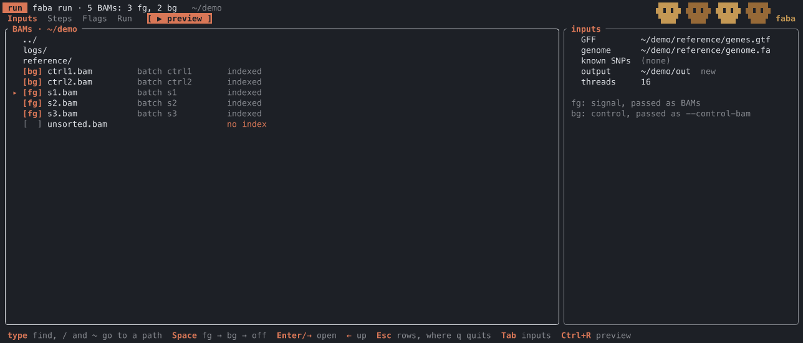
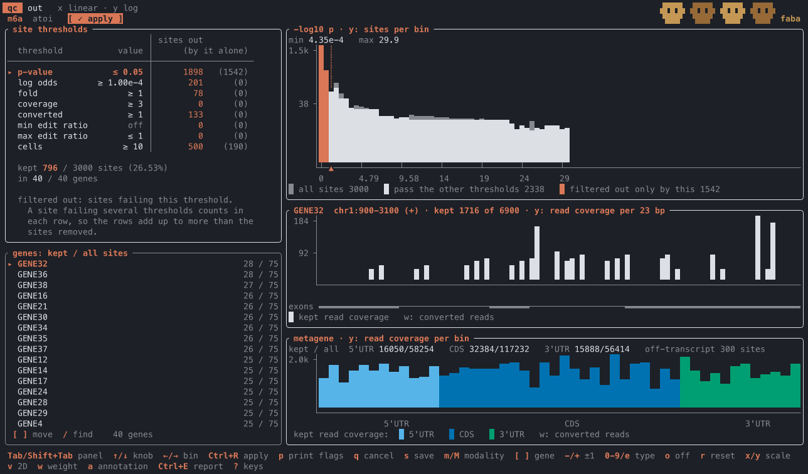
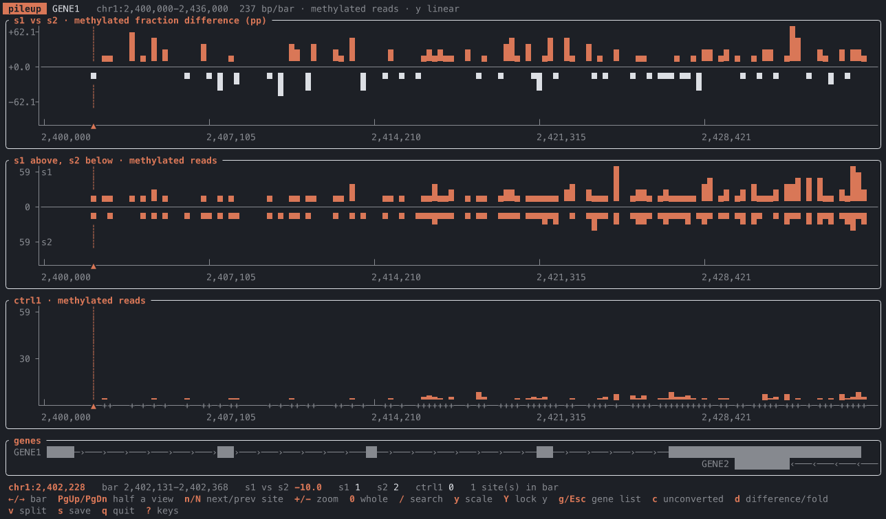
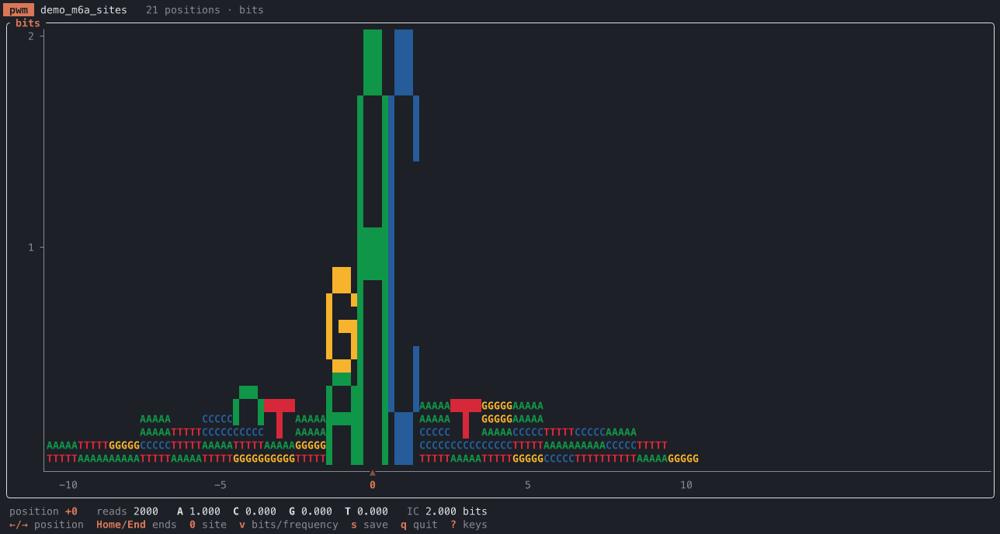

# faba

**F**eature statistics **A**ccumulator for **B**ase-pair-level **A**nalysis

`faba` extracts per-cell genomic features directly from alignment (BAM) files:
RNA modifications (DART-seq m6A, A-to-I editing), alternative polyadenylation
(APA), gene counts, read depth, and SNP genotypes.

## A quick look

Run in a terminal, `run`, `qc`, `qc-view`, `pileup`, `metagene`, `pwm` and `cluster-view` open full-screen
views; `--batch-process` skips them for scripts and clusters.

Each view runs as a detachable session: Ctrl+] leaves it running (as does a dropped
connection), and starting the command again with nothing named, or `faba attach`, returns
to it; Ctrl+\ switches to another session. `faba sessions` lists them, `faba kill`
stops one as its quit key does (a write under way finishes first) and `faba rename`
labels one. `--no-detach` runs a view in the terminal only.

The views share one set of keys. `q` quits; Esc goes back one level (out of a pop-up, a find or a
pane) and never quits a top-level view. `?` lists every key the view takes where it is, and the
footer the ones that act there. `s` saves the figure on screen, `i` switches image and text,
Ctrl+E writes the view's page, Ctrl+R applies or starts, `/` finds, `v` cycles the look, `x` and
`y` the scales, and Tab moves between panes. `faba run` stops a run with `S` (it asks; again
kills it), and refuses `q` while one runs; where leaving would lose work, `q` asks first.

**`faba run`**: pick the BAMs (signal and control), steps and flags, preview the command, and run it.



**`faba qc`**: set site thresholds, see what each one keeps, and write a filtered copy.



**`faba pileup`**: browse a gene's modification sites, one track per batch.



**`faba pwm`**: the sequence logo around the called sites.



## Installation

### Prerequisites

These must be installed **before** running `cargo install`: Cargo only builds
Rust crates and cannot pull in a C toolchain or system libraries on its own. If
they are missing, the build fails midway in the vendored-htslib build script.

- **Rust** (stable, edition 2021+): install via [rustup](https://rustup.rs).
- A **C/C++ toolchain** and the system libraries that
  [`rust-htslib`](https://github.com/rust-bio/rust-htslib) builds against
  (it vendors and compiles htslib, which needs the compression dev headers,
  and runs `bindgen`, which needs libclang):

  ```sh
  # Debian / Ubuntu
  sudo apt-get install build-essential clang libclang-dev \
      zlib1g-dev libbz2-dev liblzma-dev pkg-config

  # macOS (Homebrew)
  brew install llvm xz bzip2 zlib
  ```

### Install from crates.io

```sh
cargo install faba
```

Optional HDF5 (`.h5` / `.h5ad`) support:

```sh
cargo install faba --features hdf5
```

### Install from GitHub

`main` can run ahead of the latest crates.io release. To get what is on it:

```sh
cargo install --git https://github.com/causalpathlab/faba
```

Pin to a specific tag or branch if you need a reproducible build:

```sh
cargo install --git https://github.com/causalpathlab/faba --tag v0.20.20
cargo install --git https://github.com/causalpathlab/faba --branch main
```

### Build from a local clone

```sh
git clone https://github.com/causalpathlab/faba.git
cd faba
cargo build --release
cargo install --path .
```

### Optional features

| Feature | Enables | Extra requirement |
|---------|---------|-------------------|
| `mcp` (default) | `faba mcp`, the commands as tools for an agent | none |
| `hdf5`  | HDF5 backend + `.h5`/`.h5ad` readers | `libhdf5` on the build host |

There is no `cuda` / `metal` feature: nothing on the BAM-to-matrix path touches a
GPU.

Add them with `cargo install --features`:

```sh
cargo install --git https://github.com/causalpathlab/faba --features hdf5
```

### Verify

```sh
faba --help
```

### Troubleshooting

Almost all install failures come from the `hts-sys` build step (it compiles a
vendored copy of htslib and generates bindings with `bindgen`). The fixes:

- **`thread 'main' panicked ... Unable to find libclang`**: `bindgen` can't
  locate libclang. Install `libclang-dev` (Debian/Ubuntu) or `brew install
  llvm` (macOS), then point to it:

  ```sh
  # Linux: the unversioned symlink ships with libclang-dev
  export LIBCLANG_PATH=$(llvm-config --libdir 2>/dev/null || echo /usr/lib/llvm-18/lib)

  # macOS (Homebrew llvm is keg-only)
  export LIBCLANG_PATH="$(brew --prefix llvm)/lib"
  ```

- **`fatal error: zlib.h / bzlib.h / lzma.h: No such file or directory`**: the
  compression **dev headers** are missing (the runtime `.so` alone is not
  enough). Install `zlib1g-dev libbz2-dev liblzma-dev` (Debian/Ubuntu) or
  `brew install xz bzip2 zlib` (macOS).

- **`error: linker 'cc' not found`**: no C toolchain. Install
  `build-essential` (Debian/Ubuntu) or Xcode Command Line Tools
  (`xcode-select --install`) on macOS.

- **`failed to run custom build command for 'hdf5-sys'`**: you passed
  `cargo install --features hdf5` without `libhdf5` on the host. Install `libhdf5-dev`
  (Debian/Ubuntu) or `brew install hdf5`, or drop the feature.

If a build fails after fixing a prerequisite, re-run with a clean rebuild of the
C bits: `cargo install --git ... faba --force`.

## Usage

```sh
faba <COMMAND> [OPTIONS]
```

| Command | Purpose |
|---------|---------|
| **Feature profiling: BAM → per-cell features** ||
| `dartseq` (`dart`, `m6a`) | Call DART-seq m6A sites by a WT-vs-MUT control contrast on C-to-T conversions |
| `atoi` (`a2i`, `editing`) | Detect and quantify A-to-I RNA editing sites |
| `apa` (`polya`)           | Quantify alternative polyadenylation sites per cell |
| `count` (`genes`)         | Count reads per gene and call cells (single-cell or bulk RNA-seq) |
| `depth` (`rd`)            | Compute read depth over genomic intervals |
| `snp` (`genotype`)        | Discover and genotype SNP variants from BAM pileup |
| `run` | Set up the pipeline in a view (inputs, steps, flags), preview and save the command, and run it: SNP → count → ATOI → m6A → APA; `S` stops a run |
| **QC: choose and apply thresholds after profiling** ||
| `qc`                      | Pick thresholds in a full-screen view, then filter a faba output directory into a new fileset |
| `qc-view`                 | View what a `qc` run kept and dropped in `qc`'s site view, read only: the thresholds it applied (from `qc.run.json`) drawn, every site shown kept or dropped with its reason, each batch's cells; `s` saves the panel on screen, `--html` writes the page, `--plots -o` the figures, `--batch-process` prints the threshold table |
| `site-plot` (`sp`)        | Draw a directory's site statistics as paper panels, no QC: histograms, chosen pairs with marginals, each quantity on one scale, cells per site from the `_site` matrices; thresholds optional; PDF and PNG |
| **Clustering: cells by their own sites** ||
| `cluster`                 | Cluster cells by their site reads: cell and gene modules with a methylation shift per pair, fitted by variational inference. `--modality count` fits cell modules by gene counts instead; `--within` its run record then fits the sites within each of those cell modules (or within each group of a cell table, `--within cells.parquet`) |
| `cluster-view` (`modules`, `blocks`) | View a `cluster` fit from its run record `{m}_blockmodel.run.json`, or from its input directory (it never fits: run `cluster` first): its gene modules against its cell modules, each module's sites, the genes you pin side by side, and a gene's full pileup, one track per cell module; GO terms beside the gene modules on demand; `--html` (Ctrl+E in the browser) writes it as one self-contained page to share, `--json` and `--overview` print its levels, `--figure` draws a paper figure, `--screen` the browser's screen (with `--each-fit`, `--each-group` or `--each-module`, one each). A `--within` record (`{m}_within.run.json`) opens as the list of its fits, the count fit first; `--group C3` opens the one within a cell module |
| **Inspection & reference** ||
| `pwm`                     | Build a position weight matrix around genomic sites |
| `pileup` (`inspect`)      | Browse a gene's sites, or print an ASCII pileup, or draw the browser's figure (a WT/MUT `--track` pair mirrored over the gene model) |
| `metagene` (`mg`)         | Metagene histogram of site positions across gene features |
| `docs`                    | Print the method write-ups compiled into this binary |
| `mcp`                     | Serve the commands to an agent over the Model Context Protocol |
| `attach`, `sessions`, `kill`, `rename` | Return to, list, stop and label the views' detached sessions |

Run `faba <COMMAND> --help` for the detailed options of each subcommand.

## For an agent (MCP)

`faba mcp` serves the commands as [Model Context Protocol](https://modelcontextprotocol.io) tools over stdio, so any MCP client can drive them, with any model behind it (Claude, GPT, Gemini, or a local one). faba sends nothing anywhere itself: the model sees what the tools return, and where that goes is up to the client and model you choose.

### Connect a client

The server is one command, `faba mcp`. A client also needs to know where the project is: the server keeps its records (below) in its working directory, or in `LEGUME_MCP_PROJECT` when set. Set it whenever the client may start servers elsewhere, as desktop apps usually do. If the client cannot find `faba`, give its full path (`which faba`).

Most clients (Claude Desktop, Cursor's `.cursor/mcp.json`, Gemini CLI's `settings.json`, and others) take this shape:

```json
{
  "mcpServers": {
    "faba": {
      "command": "faba",
      "args": ["mcp"],
      "env": { "LEGUME_MCP_PROJECT": "/path/to/project" }
    }
  }
}
```

Claude Code: `claude mcp add faba -e LEGUME_MCP_PROJECT="$PWD" -- faba mcp`. VS Code takes `"servers"` with `"type": "stdio"` in `.vscode/mcp.json`; Codex CLI takes `[mcp_servers.faba]` with `command`, `args` and `env` in `~/.codex/config.toml`. Key names differ between clients; the server needs only the command, its argument and, optionally, the environment.

### What the agent does

The server tells the agent how to work when it connects (the MCP `instructions`). Some clients do not pass those to the model; with one of them, put this in the agent's own instructions (an `AGENTS.md`, a system prompt):

```text
faba turns coordinate-sorted BAM alignments into per-cell feature matrices: gene counts, read depth, A-to-I editing, DART-seq m6A, alternative polyadenylation and SNP genotypes. Row names are {gene_key}/{modality}/{detail}.

The steps, in order:
1. docs lists the method write-ups; with `query`, it prints the sections named (a topic such as profiling, a command such as qc, or a section number).
2. Producers write every candidate, with no p-value cutoff, each into a new directory: count, atoi, dartseq, apa, depth and snp one modality each; run the pipeline (SNP, then count, A-to-I, m6A, APA) at once. dartseq needs control BAMs; without them, run skips m6A.
3. qc cuts cells, features and sites into a new directory; the input is never changed. Try thresholds first with its `dry_run`, which writes nothing and returns what the cell QC keeps and what each threshold removes. qc_view reads back a cut already made: the same counts at the thresholds it applied.
4. cluster fits cells by their own reads (a blockmodel of cell and gene modules, by variational inference), in two rounds: first with `modality` count (gene counts; it writes count_blockmodel.run.json), then with `within` naming that record and `modality` m6a or atoi, a fit within each cell module ({m}_within.run.json). cluster_view reads a fit back: JSON levels (an overview by default), figures, the browser's screen or a page.
5. pileup (one gene's or region's sites), metagene (where sites sit over all genes) and pwm (bases around the sites) read a directory's sites: a table, and a figure as an image.

Which figure tool:
- site_plot: paper panels (histograms, pairs, marginals) of a directory's site statistics at any thresholds, no cut.
- qc with `plots`: the same panels and the qc view's figures, at a cut being made (or a `dry_run`); qc_view with `plots`: those of a cut already made.
- qc_view with `figure`: the one panel a saved view state arranges, with no live view.
- cluster_view with `figure` or `plots`: paper figures of a fit (the modules grid, the trace, the batches); with `screen`: the browser's screen as drawn (the grid, the sites or GO beside it, the pinned genes), and with `each_fit`, `each_group` or `each_module` one per fit, group or module.
- view_export: what the user arranged by eye in a live view.

When the user wants to arrange a figure by eye: view_open (qc_view or cluster_view; pileup, metagene and pwm open for looking only) returns an `attach` line such as `faba attach faba-qc-view-1`; give it to the user to run in their terminal. They detach with Ctrl+] when done (q ends the view, and then nothing can be read). view_state reads what they chose (and with `set` changes it), view_export draws that figure and returns `replay`, the batch command that draws it again. view_list lists the live views.

The producers (count, depth, atoi, dartseq, apa, snp, run, qc, cluster) take `background`: on large BAMs set it, and the call returns a `job` id at once; follow it with job_wait or job_status.

Every write goes to `out`, which must not exist: no tool replaces a file or a directory (when one exists, ask the user for another path). Leave `out` out and the output goes in today's results folder, named after the input and the tool. Paths resolve against the server's working directory. Every flag of a tool's command is an argument of the tool, typed, named after the flag (`--min-coverage` is `min_coverage`), but those naming the output or opening a view; `options` remains for anything else, as `faba <command> --help` lists it, and a flag given both ways is refused. A write returns the paths `written` and what the run recorded (`results`: a fit's ELBO verdict, its cluster sizes). docs gives this server's `version`. A call is refused when the faba it would run is another version than the server's, or is the server's own file rebuilt since it started: the server then needs a restart or a reconnect.
```

legume-mcp adds where the records are and the background jobs below. The project's notebook (open with a plan: the question, the data, how the result will be checked) is the `legume` server's, not faba's.

| Tool | Does |
|---|---|
| `docs` | the method write-ups |
| `count`, `atoi`, `dartseq`, `apa`, `depth`, `snp` | one modality each, into a new directory |
| `run` | the pipeline (SNP, then count, A-to-I, m6A, APA) into one directory |
| `qc` | filters a directory into a new one; with `plots`, returns its figures and site panels as images |
| `qc_view` | reads back what a `qc` run kept and dropped: its threshold table, and its figures and page when asked |
| `cluster` | fits cells by their own site reads, by gene counts (`modality` count), or by site reads within a count fit's cell modules (`within`); writes its tables to a new directory |
| `pileup`, `metagene`, `pwm` | read a directory's sites; `metagene` and `pwm` return their figure as an image, `pileup` with `figure` (the browser's figure of a gene, or several with `genes`, `row`, `grid`) |
| `cluster_view` | reads a fit as JSON levels, the overview when none is named; GO terms only with `go`; paper figures with `figure` or `plots`; the browser's screen with `screen` (one per fit, group or module with `each_fit`, `each_group`, `each_module`) |
| `site_plot` | draws a directory's site statistics as paper panels into a new directory, returned as images |
| `view_open`, `view_list` | put a view in front of the user as a detached session they attach to with the returned `attach` line (`open_window` also tries a Terminal window on macOS, giving up after a few seconds with a note), and list the live ones |
| `view_state`, `view_export` | read what the user arranged in a live view (or arrange it, with `set`), and draw the figure its `s` saves from that, its state kept beside it (`{out}.view.json`, which `qc-view --view-state` and `cluster-view --screen --state` read back); qc_view and cluster_view |
| `job_status`, `job_wait`, `job_cancel` | from legume-mcp |

Each tool's arguments are made from its command's own flags, so a new flag is a new typed
argument (`--site-max-pv` is `site_max_pv`; a figure's `--fig-width` and `--fig-height` are
`width` and `height`). `options` takes anything else, as `faba <command> --help` lists it. A key
a tool does not take is refused, naming the nearest one it does, and a flag given both as an
argument and in `options` is refused.

### Long runs in the background

On large BAMs a producer can outlast a client's wait on one call. Give it `background: true` and it returns at once with `{job, written}`; the agent follows the job with `job_wait` or `job_status` (or stops it with `job_cancel`), and uses `written` only once it is done. A job that succeeds is recorded like any step. Jobs end with their server: a run longer than a client session is for `faba` on the command line.

### One faba, one version

Each tool runs the server's own `faba` path as a child. When that file is replaced while the server runs (a `cargo install`), what happens depends on the platform. On macOS a call runs the new file: if it is another version, the call is refused, naming both versions and that the file was replaced since the server started; if it is the same version rebuilt (its size, modified time or inode changed), the call is refused as rebuilt. Either way nothing runs until the server is restarted or reconnected. On Linux the server keeps running its own image (through `/proc/self/exe`), so calls go on with the version the server started as, and its schema still matches; restart it to pick up the new faba. A `faba` the server did not start from is refused only when its version differs. The binary's `--version` is asked once per file, again only when the file changes. `docs` returns the server's `version`.

### Records and watching

Every write goes to an `out` that must not exist yet: no tool replaces a directory or a file, and no tool but `view_open` opens a view (detached, for the user to attach to; the server never waits on a terminal). A figure `view_export` draws from a live view is not in `runall.sh`; its `replay` is the command that draws it again from the state kept beside it. The server keeps the project's records the way legume-mcp lays them out, after [Noble (2009), *A quick guide to organizing computational biology projects*, PLoS Comput Biol 5(7):e1000424](https://doi.org/10.1371/journal.pcbi.1000424): every step that writes goes into the day's `results/<date>/runall.sh`, which replays the session, and into `results/INDEX.tsv`; outputs the agent does not name go in `results/<date>/`. `LEGUME_MCP_RECORDS=off` turns the records off. While an agent works, the server also writes a live feed a person can follow and steer (stop a call or a job, leave the agent a note) with legume-mcp's `watch`; `LEGUME_MCP_WATCH=off` writes none.

## Clustering on real data

`faba cluster` (cell and gene modules of the site reads) fits by variational inference, as the
count fit does: each restart (`--chains`, 4) starts from k-means++ on the cells' residuals over
their genes, runs `--svi-epochs` minibatch epochs, then coordinate ascent until an epoch moves the
ELBO by less than `--tol` per read, and the best restart by ELBO is kept. A read's likelihood is
bounded by Pólya-Gamma (Jaakkola and Jordan), one bound per read and block, so each link (a cell's
reads at one gene) weighs every block at a few sums; the shifts and the cells' levels trade a
constant through their priors after every global step. On the paper data (11,919 cells, 2.35M
links) a restart takes about two minutes. The MCMC fits faba had before 0.19 (`--model link` and
`crp`, the sampler's `--sweeps` and `--burn-in`, `--holdout`) are gone, and their flags are
refused by name; their records still open in `cluster-view`.

```sh
# Cell and gene modules from a faba output directory, watching the restarts as they run
faba cluster out/
# Open the fit, as it is
faba cluster-view out/m6a_blockmodel.run.json
```

**In two rounds.** Counts and site reads are not fitted jointly: a cell has far more UMIs than
site reads, so the counts would decide the modules alone. Instead the cells are first clustered
by their gene counts, and the sites are then fitted within each of those cell modules:

```sh
# Round 1: cell modules by gene counts (writes out/count_blockmodel.run.json)
faba cluster out/ --modality count
# Round 2: m6A (or A-to-I: --modality atoi) within each count cell module
faba cluster --within out/count_blockmodel.run.json
# The count fit and the fits within it; --group C3 opens one of them
faba cluster-view out/m6a_within.run.json
```

The count fit is by variational inference (after Gopalan, Hofman and Blei's hierarchical Poisson
factorization): each restart (`--chains`, 4) starts from k-means++ on the cells' normalized
profiles, then the genes' profiles over those clusters, then runs online minibatch epochs (`--svi-epochs` 10 of
`--batch-size` 1000 cells), then coordinate ascent until an epoch moves the ELBO by less than
`--tol` (1e-5) per count, at most `--epochs` (200) in all. Only nonzero counts are visited, and
nothing cells × genes is held dense. The tables are the best restart's by ELBO; the trace is each
restart's ELBO by epoch, and the verdict says whether the best one settled.

The second round reads the site matrices beside the count fit's inputs, unless some are named,
and matches cells by batch and barcode. Each cell goes to its main count module (`C1`, `C2`, …). A
group with fewer than `--within-min-cells` (50) cells to fit is skipped. Each group's fit is an
ordinary one under `within/{m}/{group}/`, with its
own run record and verdict; `{m}_within.run.json` lists them, and `{m}_within_cells.parquet`
gives each cell its group and its site module there. `cluster-view --html fit.html` writes the
count fit's page and `fit.{group}.html` beside it for each fitted group, linked to each other.

**Within a cell table's groups.** `--within` also takes a table of cells and their groups in
place of a count fit: a Parquet file (lupin's `{out}.cell_annotation.parquet`, with a `cell`
column and per-cell `cluster` and `label`), or a TSV or CSV of cell, then group, a line, its header
optional. The groups are taken as given and fitted as the count fit's cell modules are, into the
same files; each is named by its value, anything but letters, digits, `.`, `_` and `-` made `_`,
so `cluster-view --group CT1` opens one.

```sh
faba cluster out/ --within out/t.cell_annotation.parquet --within-column cluster
```

`--within-column` names the group column (default `label`, else `cluster`, else the other column
of two) and `--within-cell-column` the cell column (default the first of `cell`, `barcode`,
`cell_barcode` and `obs_names`; none there is refused, naming the columns found). A cell's name
is matched to the site matrices' cells as a count fit's are. faba's `{batch}_count` and
`{batch}_m6a_site` (or `_atoi_site`) matrices of one batch name their cells by the same bare
barcodes, and a table made from several count matrices read together names them
`{barcode}@{batch}_count`: so `{barcode}@{tag}` is that barcode of the batch `{tag}` names, less a
matrix kind (`b1_count` is `b1`), and that batch pairs with the sites' as a count fit's batch does
(the same name, the one named with its folder, a table of one batch with sites of one, or
`--batch-map SITES=TAG`). A bare barcode is looked for in each site batch nothing pairs with, and
left out where it is in more than one. How many site cells each group matched is logged; a table
none of whose cells is among the sites' is refused, naming a cell of each. The site matrices
default to those in the table's directory. With no count fit, `cluster-view` of the record lists
the groups' fits, and `--html` writes a page a fitted group.

**Batch effects, after the fit.** Batches fitted together can come out as modules of their own.
`cluster-view` reads each cell module's spread over the batches off the cell table, each batch's
cells weighing alike, with the batches as replicates of conditions: a batch's name less its
replicate token (`rep1_mut` and `mut_r2` are replicates of `mut`; a folder, `runA/mut`, is one
too), or as `--batch-groups rep1_mut=mut,...` says. A module even over each condition's
replicates (normalized entropy at least 0.8, each condition weighing alike however many
replicates it has) is shared, or that condition's when 80% of it is in one condition; uneven, it
is batch-specific, as a condition's replicates should agree. A module mostly where no condition
has two replicates, or with under 10 cells' worth, is not judged. In the browser, `b` opens the modules against the batches
and `B` has the panes show the modules that are not batch-specific, then those that are, then
all; `--batches` prints the same.

```bash
faba cluster-view out/count_blockmodel.run.json --batches
```

**GO terms of the gene modules.** `cluster-view --go` tests each gene module's genes (those whose
main gene module it is, at a weight of at least `--go-min-weight`, 0.5) against the fit's own genes
that GO annotates: the hypergeometric tail of the overlap, Haldane's odds ratio, and BH over every
(module, term) pair, a term listed at a BH q of at most `--go-q` (0.05; `go_q` over MCP) and
sharing 2 or more genes, for terms of 5 to 500 annotated genes, propagated up the GO graph (`is_a`,
`part_of`) with NAS and ND evidence left out. A module's terms are listed by p, a parent left out
when it holds the same genes. The annotations default to lupin's cached GO Consortium file for the
genes' species (human or mouse); `--gaf` and `--obo` name others, `--gmt` any gene sets. In the
browser, nothing reads GO until `a`: it reads the terms, then shows a column beside the gene
modules, each module's strongest terms with their q on its own row (`a` again hides or shows it;
on a screen too narrow for it the footer says so); `G` opens the gene module in focus's terms in
full (↑/↓ steps the module, `G` or Esc closes it). MCP's `cluster_view` takes `go`.

```bash
faba cluster-view out/m6a_blockmodel.run.json --go
```

**The look of a grid.** In the browser `v` cycles each grid through mirror bars, a % heatmap, a
heatmap of each row's z across the cell modules, and a Hinton diagram of that z (a square per
block, its area by |z| against the largest). `--figure` takes the same as `--look shift`,
`percent`, `z` or `hinton`. Ctrl+E writes the browser's page, as `--html` does.

```bash
faba cluster-view out/m6a_blockmodel.run.json --figure grid --look hinton --fig-width 3.5
```

The grid's figure takes more, each off by default. `--size-bars left,top` (or `left,bottom`; bare:
`left,top`) draws each gene module's size in genes as a bar by its row and each cell module's size
in cells (as `--cells` prints it) by its column; `--read-bars` takes the same sides and draws each
module's reads, summed over its blocks, as the browser's mirror bars (converted out or up,
unconverted the other way, one scale a side). `--marginal-size` sets their depth as a fraction of
the grid's shorter side (default 0.15); the largest of each is labelled. `--go-labels N` lists up
to N of each gene module's GO terms (or `--gmt` sets) on its right, a line each within its row, the
q after the name, e.g. `SET1_NAME (q 1.1e-2)` (read only with this flag; `--gaf`, `--obo`, `--go-q`,
`--go-min-weight` apply). The terms go by p, each left out whose overlap genes are 80% or more
those of one already shown, so a parent set and its child give one line. The names take the width
the page leaves beside the grid, shortened past it at a word's end; fewer than N show only where
the row is too shallow for N lines. A module with no term is left blank; `--go-none` says "none at
q <= Q" there, as the browser's GO column does. `--key` keeps a small key under the grid with `--panel-only` (for
`--look hinton`, squares at reference |z| beside the colours). `--values` prints each block's value
(z to a tenth, the shift to a hundredth, the %) at the font size, left out where it does not fit
in its cell. A figure asked for smaller than it can be drawn is refused, naming the least size it
is drawn at.

```bash
faba cluster-view out/m6a_blockmodel.run.json --figure grid --look hinton --fig-width 4.6 \
  --fig-height 2.6 --font-size 7 --panel-only --size-bars left,top --read-bars left,top \
  --go-labels 2 --key --values
```

**The levels for a program.** `--overview` prints the fit at a glance: the verdict, how many gene
and cell modules, each cell module's size, and each gene module's genes and top genes by weight. It
reads no GO; `--go` beside it does. `--grid` prints the modules grid beside the levels named (it is
what no level prints). `--json` prints the levels asked for as one JSON object, a key a level
(`overview`, `modules`, `cells`, `module`, `gene`, `batches`, `go`, `trace`, `settings`), each
with its rows as objects: a value and reads (a count fit's cells) in each cell module, a site's
counts, a batch's share, a restart's ELBO points, and for GO each module's terms (id, name,
namespace, k, n, K, N, odds, p, q, genes) or why it has none, with the q a term needs (`go_q`) and
the weight a gene needs. A within record prints its count fit's grid, its groups and each group's
grid. MCP's `cluster_view` returns every level this way, the overview when none is named.

```bash
faba cluster-view out/m6a_blockmodel.run.json --batch-process --overview --json
```

**Watching the restarts.** On a terminal `faba cluster` draws each restart's ELBO live while it
fits (`q` cancels, Ctrl+C stops the restarts early and writes what they reached). When it is done
it prints the same traces as one sparkline per restart on one scale, then a verdict and one line
of advice naming the flags to run again with. Once the tables are open, the browser's header
carries an `ELBO ... ok` or `check` badge, and `t` opens the trace view; `--html` pages carry the
trace chart too. Each restart's trace is kept in `{m}_trace.parquet`.

**Judging convergence.** A fit has converged when the best restart's ELBO settled within `--tol`
per unit (count or read) before `--epochs` ran out; the verdict also gives the spread of the
restarts' ELBO per unit, how far apart their optima are. `{m}_blockmodel.run.json` keeps each
restart's ELBO and epochs, the best, and whether it settled, under `results.fit`. When it has not
settled, run again with more `--epochs`; restarts far apart point to more roles than the data
support: try fewer `--cell-roles` or `--gene-roles`, or more `--chains`.

## Figures for a paper

Every figure faba writes takes its size on the page in inches: `--fig-width` and `--fig-height`,
either or both (the other is then the figure's own). It is laid out for that size, its text set in
points as it prints, and its outer size is kept exactly as asked, down to 1 by 0.75 inches. This
holds for `metagene --figure`, `pwm --figure`, `qc --plots` (and `qc-view`), `site-plot`,
`cluster-view --figure` (where `--width` and `--height` still work) and `pileup`'s figure (5
inches wide unless given; its plots share the height given). A few figures keep a larger floor
and say the least they need when asked for less: `pileup`'s Miami plot (with `--bam` or
`--cell-membership`) and `cluster-view`'s
`--plot trace` and `--plot batches` (2 by 1.5 inches, their margins fixed), and `qc`'s full knob
figure (its table and plots: 10 inches across) unless `--panel-only` draws the plot alone.

The figures but `pileup`'s Miami plot take the same look: `--font-size` sets every label in points (by default
the text is fit to the page; a font above 8 points needs a page grown alike, and a page too small
for it is refused, naming the size it needs), `--panel-only` draws the plot, its axes and their
titles only (no title, file name, key or notes), and `--palette colour|gray` draws kept and removed
(or a grid's blocks) in colour or in grays; in gray, `pwm`'s letters and `metagene`'s regions
each take a shade of their own. Each is written as PDF, its labels as text, and PNG.
`pileup` writes SVG and PDF (`--png` for a PNG too); its figure is what the browser saves with
`s`: by default (`--window sites`) at the gene's sites, of any track: centred on them, their span
and a quarter of it either side but 1 kb at least, kept within the gene (`--pad` instead runs from
the first site to the last with that many bases either side), the gene model cut there and its cut
ends marked; `--window gene` draws the whole gene, TSS to TES, as the browser
opens (`0` there steps to the sites and back, `W` for every marked gene). The gene model is on top, titled by the gene symbol, and two alike tracks
(`--track WT=... --track MUT=...`) one above the other mirrored on one zero line and one y scale,
the converted reads in front of the total, laid out from the font down to about 1 by 2.5 inches
(a page its rows cannot fit is refused, naming the least that is drawn). It is drawn as the
browser draws that window on a 110-column terminal: the same bases per bar (`--bins` sets the bars
across instead), the y scale `--yscale linear|sqrt|log10` (`log1p` names log10 too; `y` in the
browser), sqrt labelled at evenly spread round counts (500, 1k, 1.5k) and log10 at powers of ten
up each arm, its top too where it is one, the arms' names clear of those labels and of the bars, the difference
row only with `--difference` (`D` hides it in the browser), two or three position ticks in Mb on a
small page, at round positions, flat where they fit (moved in at a panel's ends), else turned, the
chromosome under them naming the unit.
In `--palette gray` the converted reads are near black over their total in light gray. The key to the colours goes
`--key-at inside` (under the plots), `right` (beside them) or `alone` (`{out}_key`, `K` in the
browser); `--panel-only` leaves it out unless `--key`.

Many genes at once: `-q GENE1,GENE2,...` (or `--gene-file`, a gene a line) writes a figure
each, `{out}_{SYMBOL}.svg` and `.pdf`, each at `--fig-width` by `--fig-height`, and `--row` (or
`--grid COLSxROWS`) one figure of them all side by side, `{out}_row` (`{out}_grid`): each panel at
that size, one y scale choice, one key for all, the y axis titled on the first panel of each row
only, the others' plots taking that room. In the browser, mark genes in the gene list
(Space), open them together (the apply key) and `s` writes the same files from the view as it is
drawn (`|` lays them out one under another, side by side or in a grid). Over MCP, `pileup` takes
`genes` as a list, `gene_file`, `row`, `grid`, `window`, `pad`, `yscale`, `difference`, `key` and `key_at`, and
returns the figures as images. The Miami plot, drawn
for `--bam` read depth or `--cell-membership` cell types, takes `--celltype-palette` for the cell
types. Over MCP, each figure tool takes `width` and `height`, and each takes `font_size`,
`panel_only` and `palette`; `site_plot`, `qc`, `qc_view`, `pwm`, `metagene` and `cluster_view`
take `xlab` and `ylab`. MCP's `cluster_view` draws several of its figures in one call
(`plots`: modules, trace, batches), each returned as an image at the `width` and `height` given.

`faba site-plot DIR -o OUT` draws one modality's site statistics as panels and nothing else:
`--hist` quantities (pv, fold, log_odds, coverage, converted, edit_ratio, cells), `--pairs x:y,...`
two at a time (default: the pairs `qc` picks), `--marginals top,right` (or `both`) on the pair's
own axes, and `--bins` along each axis. `--style view` draws each panel as the `qc` view draws it,
the control arm (MUT) against the signal arm (WT): a histogram as its knob's (MUT's sites light gray
behind, WT's filtered out by any threshold white and outlined over its retained by every one, dark;
each threshold dashed orange-red at the cut between bars, its bin split there, with the words for
either side, e.g. `p > 0.05 | p <= 0.05`, each on its own side where it fits; ticks at the bins'
edges spread evenly, at least four where they fit; a key at the right; the counts on a square-root
axis ending at a round count over the tallest bar, and the view's bins unless `--bins` is given), a pair as its 2D panel (MUT's squares behind WT's, its
marginals alike), with marginals `--marginal-size` of the plot's shorter side deep (0.2 unless
given; the default panel style keeps its own). MUT is drawn where a quantity has a value on each arm:
the coverage, the converted reads (each arm's own) and the edit ratio; in a histogram also the
p-value, WT on the WT-vs-MUT p its threshold reads (so its line splits filtered out from retained)
and MUT on its own reads tested alone against sequencing error (the beta-binomial test the A-to-I
sites are called by, at its default error rate and overdispersion; its title and key say so), and
the cells, counted on the control batches' `_site` matrices (the batches a run
record names as `control_bam`; the cells threshold still reads the cells pooled over every batch).
The fold and the log odds compare the arms, so those draw WT alone and the key says so (the
coverage's threshold adds both arms' reads, as its words say). The p-value's bars sit on log-spaced p
(unless `--scale pv=...` asks otherwise), ticked at round p, the last bar holding every p at or below
a round cap (`<= 1e-30`, from where the WT-vs-MUT p reach), at which the 2D panels' p axis ends too. `--front mut` draws MUT in front, `--p-axis neglog10` labels the p-value's
ticks as -log10 p (p itself unless asked; the bars stay), and `--panel-only` drops the title and the
key, which `--key` keeps; `--key-at right|top|inside|alone` puts it beside the plot (which narrows by its
width; a key that would leave the plot under 60% of the panel's width is drawn smaller, else at the
top, as on a panel under about 4 inches at 7 points), in a row above the plot (two rows, or the short
names `MUT`, `WT filtered`, `WT kept`, where one row does not fit; the plot keeps its width and loses
only that row's height, and no threshold's words give way to it), over the plot's top right corner
(the plot keeping its width), or in a figure of its own,
`{stem}_key`, one key for a row of panels. `--yscale pv=sqrt,cells=log1p` (or one scale for every
quantity) sets a histogram's count axis, linear, sqrt or log1p (sqrt unless asked; `y` steps the
focused one in the view); `--marginal-scale` a marginal's (log1p unless asked, so one busy bar leaves
the others a depth that reads; its axis drawn beside it at the panel's type and ticked at a round
count over its busiest bar) and `--count-scale` a 2D square's shade (log1p unless asked; in gray
from half the ink to all of it, clearly darker than MUT's light gray). The cells per site
are read off the `{batch}_{modality}_site` matrices, over every cell, with no cell QC. Each quantity is read on one scale, range and set of bins in
every figure (`--scale pv=log,fold=linear` to change one), so ticks line up across panels.
Thresholds, the `--site-*` flags named as `qc`'s, are optional: given ones are drawn as dashed
lines, and the sites they remove are shaded apart from those kept; with none, every site is kept.
`--xlab q=TEXT` and `--ylab q=TEXT` (a quantity each, repeated for more) retitle a quantity's axis in
every panel of it, on either axis unless given for both; `--ylab sites=TEXT` retitles the
histograms' counts. `qc --plots` takes the same options and writes the same panels, at its
thresholds, under `qc_plots/panels/`; in `qc-view`, `s` saves the panel on screen, as drawn there:
`f` puts the other arm in front, `u` switches the p-value's ticks between p and -log10 p, and `t`
types the x and then the y title of the panel `s` saves (empty for its own). `pwm --figure`
and `metagene --figure` take `--xlab TEXT` and `--ylab TEXT` for their one panel's axes, and
`cluster-view --figure` for `--plot trace`'s (the modules grid and the batches have no axis titles:
there they are unused, and a note says so); the
logo's position labels thin (every 5, then 10, 0 always shown) when they would run together.

`pileup --track LABEL=PATTERN,...` groups its input files into tracks, and the figure draws a
panel each (per cell type with `--cell-membership`), each with its read depth from the BAMs its
pattern matches. Without `--track` the figure pools every file.

```bash
# A column-wide modules grid and a page-wide logo
faba cluster-view out/m6a_blockmodel.run.json --figure grid --fig-width 3.5 --fig-height 3
faba pwm out/ -f genome.fa --batch-process --figure logo --fig-width 7
# Panels 1.8 inches square, text at 6 points, plot and axes only, in gray
faba site-plot out/ -o panels/ --hist pv,cells --pairs pv:cells --marginals top,right \
  --fig-width 1.8 --fig-height 1.8 --font-size 6 --panel-only --palette gray --site-max-pv 0.05
# Panels drawn as the qc view draws them, 2.4 by 1.8 inches at 7 points, short marginals
faba site-plot out/ -o panels/ --style view --hist pv,cells --pairs pv:cells --marginals both \
  --marginal-size 0.1 --fig-width 2.4 --fig-height 1.8 --font-size 7 --site-max-pv 0.05
# The same, MUT in front, -log10 p on the ticks, alone but for the key
faba site-plot out/ -o panels/ --style view --hist pv,coverage --front mut --p-axis neglog10 \
  --panel-only --key --palette gray --site-max-pv 0.05
# Axis titles of their own, a quantity each
faba site-plot out/ -o panels/ --hist none --pairs pv:cells --panel-only \
  --xlab pv="-log10 p (wt vs. mut)" --ylab cells="cells with a converted read"
faba pwm out/ -f genome.fa --batch-process --figure logo --fig-width 2 --font-size 7 --panel-only \
  --palette gray --xlab "position relative to the site (nt)" --ylab "information (bits)"
# The same panels from a qc output, at the thresholds it applied
faba qc-view out_qc/ --plots -o figures/ --hist pv,cells --panel-only
# Seven genes' pileups, an inch by 2.5 each at 7 points, WT over MUT, and all of them in a row
faba pileup out/ -q GENE1,GENE2,GENE3 --batch-process --gtf genes.gtf \
  --track 'WT=*_wt_*' --track 'MUT=*_mut_*' --fig-width 1 --fig-height 2.5 --font-size 7 \
  --panel-only --row --key --key-at alone --out panels/pileup
# A Miami plot with a panel per condition
faba pileup out/ -q GENE1 --batch-process --gtf genes.gtf --bam s1_wt_rep1.bam s1_mut_rep1.bam \
  --track 'wt=*_wt_*,mut=*_mut_*' --out gene1_miami --png
```

## Methods

The method write-ups are **compiled into the binary** (`include_str!`, not files read at
runtime), so they travel with a `cargo install`ed `faba` or one copied to a cluster with no
checkout beside it, and the build fails if one of them goes missing.

```sh
faba docs                # list what there is
faba docs profiling      # BAM -> per-cell features: m6A, A-to-I, APA, counts, SNPs
```

The same files live in [`docs/`](docs/), which also carries the design notes for work that is
planned but **not implemented** (kept separate on purpose: reading a plan as though it described
the code is how people end up debugging things that were never built).

### Examples

```sh
# Gene counts and cell calling from a single-cell BAM
faba count sample.bam -g genes.gff -o out/

# A-to-I editing sites (every putative site is written; `faba qc` decides)
faba atoi sample.bam -g genes.gff -f genome.fa -o out/

# DART-seq m6A: signal (WT APOBEC1-YTH) vs catalytically-dead control (YTHmut).
# A control is REQUIRED: m6A can't be told apart from genomic C/T variation
# without it (--mut / --control / --background are accepted aliases).
faba dartseq wt.bam --control-bam ctrl.bam -g genes.gff -f genome.fa -o out/

# Everything in one pass (the m6A step runs only when --control-bam is given,
# otherwise it is skipped; the other steps need no control).
# Set up and run everything in a view (plain `faba run`), or straight through:
faba run
faba run --batch-process sample.bam -g genes.gff -f genome.fa -o out/ --control-bam ctrl.bam

# The producers apply no p-value / effect-size / reproducibility cutoff.
# Pick the thresholds in a full-screen view, then cut into a NEW directory
# (plain `faba qc` asks for both directories in a pop-up):
faba qc out/ -o out_qc/
# ...or, in a script, cut with the thresholds as given:
faba qc out/ -o out_qc/ --batch-process --site-max-pv 0.05 --site-min-cells 10 --auto-cutoff
```

## License

MIT: see [LICENSE](LICENSE).
